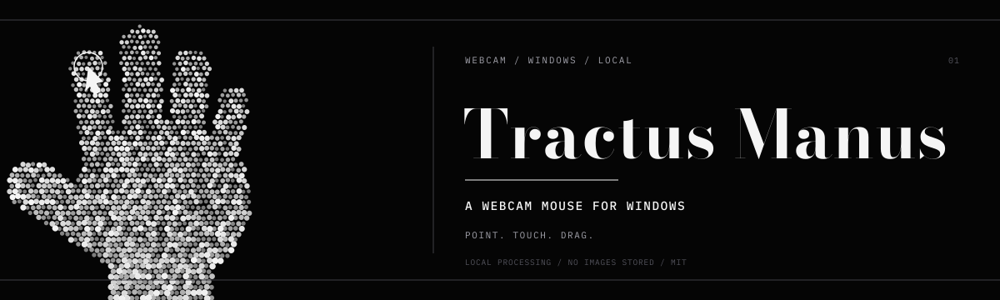
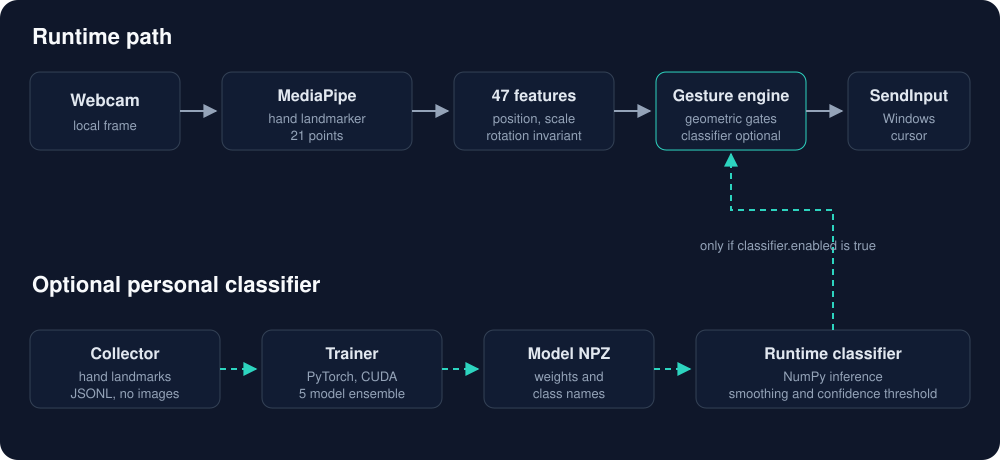

<p align="center">
  
</p>

<p align="center">
  <a href="https://github.com/0xMinomus/tractus-manus/releases/latest"></a>
  
  
  <a href="LICENSE"></a>
  <a href="https://github.com/0xMinomus/tractus-manus/actions/workflows/ci.yml"></a>
</p>

# Tractus Manus

Tractus Manus turns a Windows webcam into a mouse. Point with your index finger to move the cursor. Touch your thumb and index finger together to click. Hold them close without touching to drag. Scroll with two fingers and pause with a closed fist.

The application runs locally. It does not save webcam frames, and it does not send them anywhere. One or two hands can be visible, with one cursor on screen.

The public release works with geometric gesture rules out of the box. You can also record your own hand landmarks and train an optional personal classifier for ambiguous pinches. Training is optional and stays on your machine.

## Download and run

The recommended way to install is the Windows release:

1. Install [uv](https://docs.astral.sh/uv/) if it is not already installed.
2. Download `tractus-manus-1.0.0-windows.zip` from [GitHub Releases](https://github.com/0xMinomus/tractus-manus/releases/latest).
3. Extract the ZIP and run `setup.bat` once. It installs Python 3.12 and the dependencies into `.venv`.
4. Run `run.bat`.

The release includes the MediaPipe hand landmark model. It does not include a personal classifier. Geometric gestures work immediately; see [Training a personal classifier](docs/TRAINING.md) if you want to add one.

## From source

```bat
git clone https://github.com/0xMinomus/tractus-manus.git
cd tractus-manus
uv python install 3.12
uv sync
copy config.example.json config.json
.venv\Scripts\python.exe main.py
```

`config.json` is optional. If it is missing, Tractus Manus uses the defaults in `handtrack/config.py`, with the optional classifier disabled.

## Requirements

- Windows 10 or Windows 11, 64 bit.
- A working webcam. A 720p camera at 30 or 60 fps is enough.
- [uv](https://docs.astral.sh/uv/) for installation. Python 3.12 is installed by uv.
- About 1 GB of free disk space for the Python environment. The MediaPipe model is 7.5 MB.
- Optional for retraining: an NVIDIA GPU with a current driver, or CPU training. PyTorch is not installed by the default runtime setup.

## Gestures

Point the camera at your hand with the palm facing the camera. The right hand is preferred when both hands are visible. If the right hand disappears, the left hand can take over after a short lock.

| Gesture | Action |
| --- | --- |
| Move the index finger | Move the cursor |
| Touch thumb and index fingertips together | Left click, once per contact |
| Hold thumb and index close but not touching for about 300 ms | Hold the left button and drag |
| Touch, open the gap, touch again | Double click |
| Thumb and middle finger pinch, then release | Right click |
| Tight thumb and ring finger pinch, then release | Middle click |
| Index and middle fingers extended, hold about 120 ms | Enter scroll mode; move the hand up or down |
| Closed fist, hold about 1 second | Pause or resume |
| Open palm | Neutral, no action |

The cursor freezes while a click is being decided. This keeps the click at the intended position. The touch threshold, near-pinch threshold, and hold time are configurable. See [Configuration](docs/CONFIGURATION.md).

Middle click is optional. Press `M` or `Ctrl+M` while the preview is focused to toggle it at runtime, or set `gestures.middle_click` to `false` in `config.json`.

## Keyboard controls

These keys work when the preview window has focus.

| Key | Action |
| --- | --- |
| `Q` or `Esc` | Quit and release all mouse buttons |
| `P` | Pause or resume |
| `M` or `Ctrl+M` | Toggle middle click |
| `[` or `]` | Decrease or increase cursor smoothing |
| `,` or `.` | Decrease or increase input sensitivity |
| `H` | Swap the left and right hand labels |
| `R` | Reset the cursor filter and position |
| `D` | Toggle the debug overlay |
| `T` | Toggle always-on-top for the preview |

Use `--no-preview` when you control a fullscreen application and the always-on-top preview interferes with it. With the preview off, exit with `Ctrl+C` in the terminal.

Fullscreen applications vary. A borderless window usually accepts `SendInput`; exclusive fullscreen or games with raw input may ignore it. If the preview causes lag in a fullscreen app, press `T` or run with `--no-preview`.

## How it works



1. MediaPipe Hand Landmarker finds 21 hand landmarks in each frame.
2. The hand landmarks become a 47 value feature vector that is invariant to image position, scale, rotation, and left or right hand.
3. A gesture engine applies distance thresholds, stability windows, and cooldowns. It also handles the cursor mapping and pointer lock during a click.
4. Windows `SendInput` sends cursor movement and mouse events.
5. An optional classifier can replace the choice of ambiguous pinch or pose labels. The classifier only selects gestures; it does not move the cursor.

The cursor uses a One Euro filter, so it is steady when the hand is still and follows quickly when the hand moves. The preview shows the hand skeleton, active hand, gesture state, and a small screen map.

## Configuration

The full reference is in [docs/CONFIGURATION.md](docs/CONFIGURATION.md). The defaults work on most laptops. Copy `config.example.json` to `config.json` to edit them.

The most useful settings:

| Setting | Default | Meaning |
| --- | --- | --- |
| `camera.index` | `0` | Webcam index. Try `1` if another camera is open. |
| `camera.swap_handedness` | `true` | Swap the left and right labels if MediaPipe reports them backwards. |
| `control.sensitivity` | `1.2` | Larger values make screen corners easier to reach. |
| `control.active_area` | `0.12..0.88`, `0.1..0.8` | Camera region mapped to the screen. |
| `gestures.touch_press` | `0.18` | Pinch distance that counts as touching the fingertips. |
| `gestures.left_hold_ms` | `300` | Time in the near-pinch zone before hold and drag begins. |
| `gestures.pause.hold_ms` | `1000` | Fist hold time for pause. |
| `gestures.classifier.enabled` | `false` | Enable a personal trained classifier. |
| `gestures.classifier.smoothing` | `0.6` | Classifier probability smoothing. Higher is steadier but slower. |

## Training a personal classifier

The release runs without a trained classifier. If your pinches are often ambiguous, you can record your own hand landmarks and train a small model. The model runs in NumPy at runtime and is optional.

The workflow is:

```bat
collect.bat
train.bat
```

The collector writes only hand landmark coordinates, labels, frame dimensions, and timestamps to `data/gestures.jsonl`. It does not write images or video. The trainer uses PyTorch and produces `models/gesture_classifier.npz`. The default training run uses five MLP models with label smoothing, and reports per-class recall, precision, and F1.

Read [docs/TRAINING.md](docs/TRAINING.md) for the recording protocol, session structure, validation, and tuning. Training data, backups, and classifier weights are excluded from Git and from the release ZIP.

## Privacy and security

- Camera frames are processed in memory. Tractus Manus does not save images, video, or audio.
- The training collector stores only 21 hand landmark coordinates per frame, plus a label, session name, frame size, and timestamp. It does not store pixels.
- Training data and personal classifier weights are ignored by Git and excluded from releases. This repository contains no face images and no training recordings.
- There is no telemetry, account, or analytics endpoint.
- The only network access in the runtime is the one-time MediaPipe model download if `models/hand_landmarker.task` is missing. The download is checked against a SHA-256 hash. Release ZIPs include the model.
- Model files are loaded with NumPy `allow_pickle=False`.
- Running as administrator is not required. Some elevated applications only accept input from an elevated process.

For vulnerability reporting, see [SECURITY.md](SECURITY.md). For a planned disclosure or a question about the camera data path, open a GitHub issue without attaching personal recordings.

## Development

Requirements: Windows, `uv`, and Python 3.12. The test suite does not use a webcam.

```bat
uv sync --group dev
uv run pytest -q
uv run ruff check .
```

The CI workflow runs the tests and lint on Windows. The training test skips automatically when PyTorch is not installed.

Release and packaging instructions are in [docs/RELEASING.md](docs/RELEASING.md).

## Project layout

```text
main.py                     Application entry point
collect_hand_data.py        Landmark recording entry point
train_gesture.py            Optional classifier trainer
collect.bat / train.bat     Windows launchers
handtrack/
  app.py                    Camera loop, actions, keyboard
  camera.py                 Camera opening and frame resize
  classifier.py             47 feature extractor and NumPy classifier
  collector.py              Landmark recorder
  config.py                 Typed configuration and validation
  cursor.py                 Screen mapping, One Euro filter, freeze
  filters.py                One Euro filter implementation
  gestures.py               Gesture state machine
  hands.py                  MediaPipe wrapper and hand features
  input.py                  Windows SendInput backend
  mapping.py                Coordinate mapping
  overlay.py                Preview HUD
  training.py               Dataset loader, trainer, metrics
  winapi.py                 DPI, screen bounds, window helpers
models/
  hand_landmarker.task      MediaPipe hand model
  README.md                 Model source and license notes
docs/                       Configuration, training, troubleshooting, release docs
tests/                      Unit tests without a camera
```

## Current limitations

- Windows only. The mouse backend uses `SendInput`.
- One cursor at a time. Two hands are used for handoff, not for two cursors.
- The preview HUD and console messages are currently in Indonesian. The code, documentation, and release notes are in English.
- The public release does not include a personal classifier. Geometric gestures are the default.
- Exclusive fullscreen, raw input, and some anti-cheat protected applications may ignore synthetic mouse input.
- A webcam that only sends black frames, or a blocked camera permission, will prevent tracking. The preview logs a warning after a few seconds.

## Contributing

Issues and pull requests are welcome. Read [CONTRIBUTING.md](CONTRIBUTING.md) before changing the gesture engine or the training format. Changes to thresholds should include a test using synthetic landmarks.

## License

The source code is released under the [MIT License](LICENSE). The MediaPipe hand model and the Python dependencies keep their own licenses. See [THIRD_PARTY_NOTICES.md](THIRD_PARTY_NOTICES.md) for details.

Tractus Manus is not affiliated with Google or MediaPipe.
